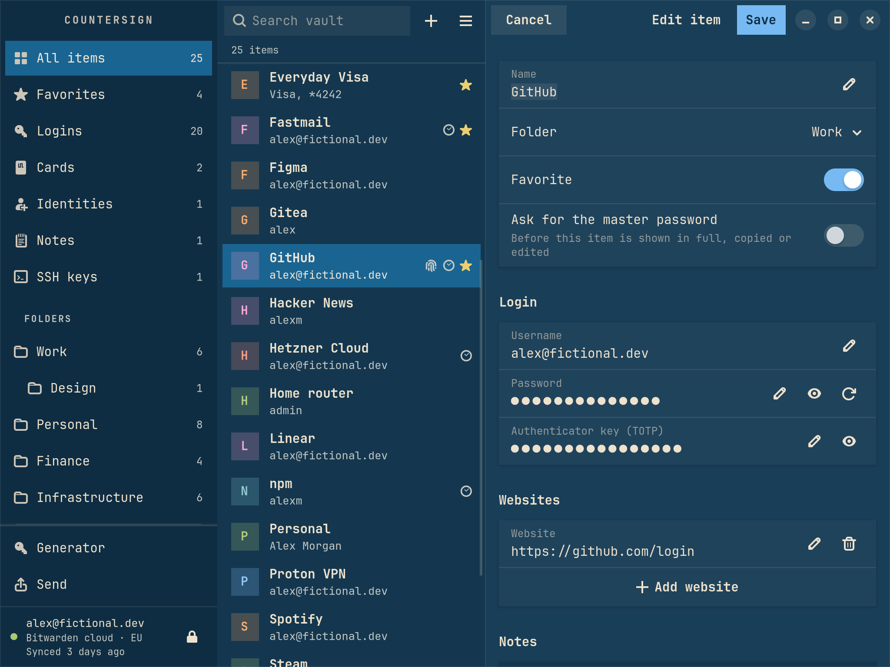
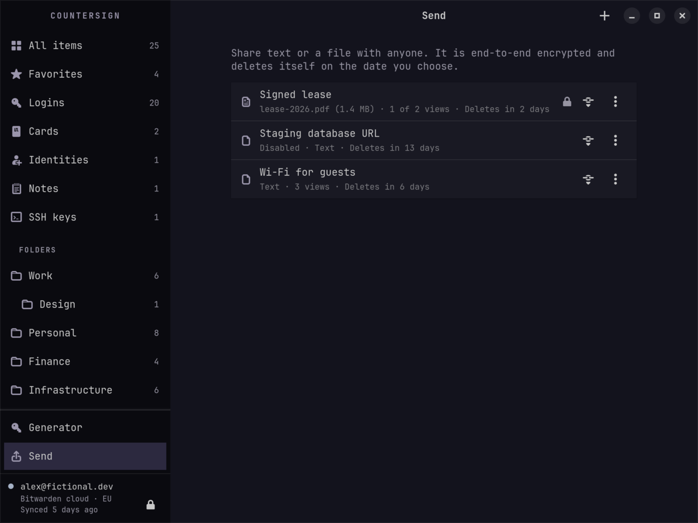

<p align="center">
  
</p>

# Countersign

A fast, keyboard-first desktop app for Bitwarden on Omarchy and other
Hyprland desktops, written in Rust and built on the official Bitwarden CLI.


Countersign is an independent project, not affiliated with or endorsed by
Bitwarden, Inc. It never implements Bitwarden's encryption and never talks to
Bitwarden's servers itself. The official CLI does both; Countersign is the
interface and the desktop integration around it.

## What it does

- **Quick access.** A launcher-style overlay: type a few letters, press
  Enter, and the password is on the clipboard. Recent items come first.
- **The whole vault.** Logins, cards, identities, notes and SSH keys, with
  folders, organization collections, favorites and trash, and a password and
  passphrase generator. Secrets stay masked until you
  reveal them. Verification codes count down live.
- **Editing.** Create and edit logins, cards, identities and notes, with
  websites and custom fields; SSH keys keep their key and the rest can be
  edited. Manage folders and attachments, move items to an organization,
  and trash, restore or delete forever.
- **Send.** Share text or a file through Bitwarden Send. A new Send's link
  goes straight to the clipboard.
- **A clipboard that cleans up.** Copies clear themselves after 30 seconds
  and are marked so Omarchy's clipboard history skips them. After a password
  copy, the item's one-time code replaces it a few seconds later.
- **Locks when you do.** On request, after inactivity, when the screen locks
  and before the computer sleeps.
- **Looks like Omarchy.** Follows the active theme's palette and Hyprland's
  corner rounding, light or dark, and switches with the theme.


| Omarchy Flexoki Light | Omarchy Tokyo Night |
| --- | --- |
|  |  |

| Editing an item | Send |
| --- | --- |
|  |  |

Screenshots use a fictional demo vault; see `scripts/screenshots.sh`.

## Status

Early, with no release yet: you build it from source. Everything above
works today. [The roadmap](docs/ROADMAP.md) lists the known limitations, and
[Performance](docs/PERFORMANCE.md) has the measurements.

## Quick start

On Omarchy, or another Hyprland desktop with GTK 4.18+ and libadwaita 1.7+:

```bash
git clone https://github.com/BVisagie/countersign.git
cd countersign
scripts/install.sh
```

Add quick access and autostart to Hyprland:

```lua
-- ~/.config/hypr/bindings.lua
o.bind("SUPER + SHIFT + P", "Passwords", "countersign --quick")
-- ~/.config/hypr/autostart.lua
o.launch_on_start("countersign --background")
```

Open Countersign. It offers to install the official Bitwarden CLI, checked
against the SHA-256 recorded in its source, then signs you in. Countersign
works with the official CLI **2026.10.0 or newer**, and installs 2026.10.1
when you let it.

- [Installing](docs/INSTALL.md): requirements, choosing a CLI, updating,
  uninstalling and troubleshooting.
- [Using Countersign](docs/USAGE.md): sign-in, quick access, copying,
  editing, Send, locking and settings.

## Keys

| Key | Action |
| --- | --- |
| `Enter` | Copy the password, card number or note |
| `Shift+Enter` (quick access) | Copy the username or security code |
| `Ctrl+C` / `Ctrl+B` / `Ctrl+T` | Copy the password / username / verification code |
| `Ctrl+U` | Open the website |
| `Ctrl+O` (quick access) | Show the item in the main window |
| `Ctrl+F` or `/` | Search |
| `Ctrl+R` | Sync |
| `Ctrl+L` | Lock |
| `Ctrl+N` | New login |
| `Ctrl+G` | Password generator |
| `Ctrl+,` | Settings |
| `Esc` | Clear the search, then close quick access |

More in [Using Countersign](docs/USAGE.md).

## How it works

See [ARCHITECTURE.md](docs/ARCHITECTURE.md) and [SECURITY.md](docs/SECURITY.md).

## License

[GNU General Public License v3.0 or later](LICENSE).
