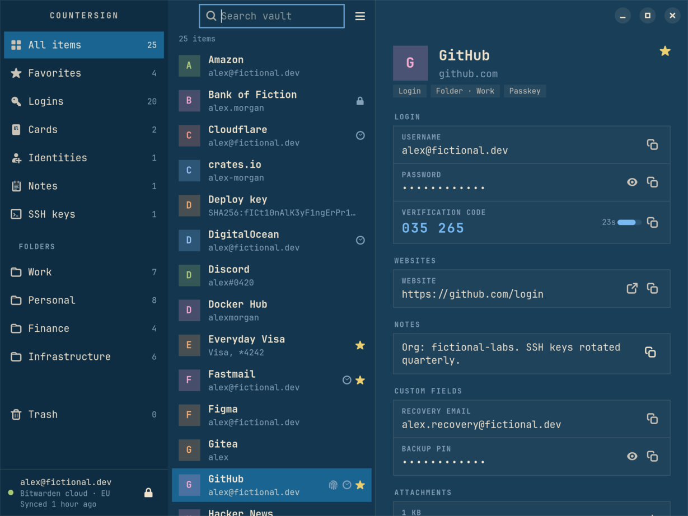
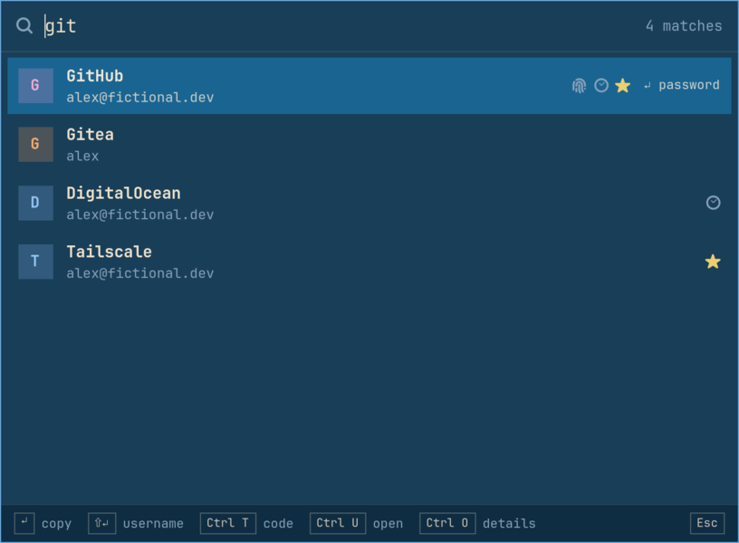
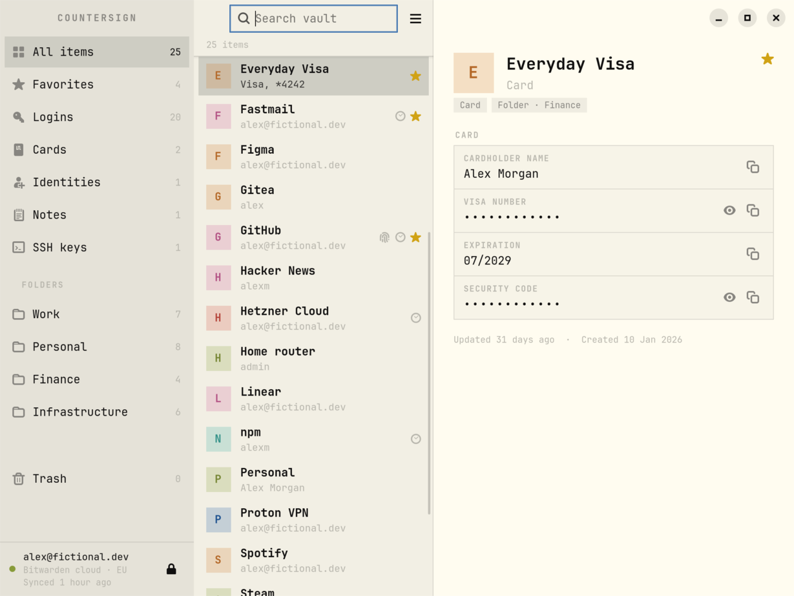
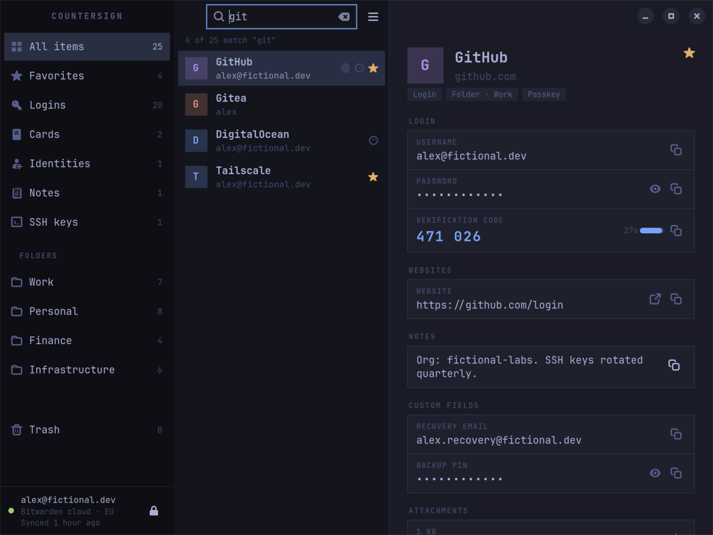

# Countersign

A fast, keyboard-first desktop app for Bitwarden on Omarchy and other
Hyprland desktops, written in Rust and built on the official Bitwarden CLI.



Countersign is an independent project, not affiliated with or endorsed by
Bitwarden, Inc. It never implements Bitwarden's encryption and never talks to
Bitwarden's servers itself. The official CLI does both; Countersign is the
interface and the desktop integration around it.

## What it does

- **Quick access.** A launcher-style overlay: type a few letters, press
  Enter, and the password is on the clipboard. Recent items come first.
- **The whole vault.** Logins, cards, identities, notes and SSH keys, with
  folders, collections, favorites and trash. Secrets stay masked until you
  reveal them. Verification codes count down live.
- **A clipboard that cleans up.** Copies clear themselves after 30 seconds
  and are marked so Omarchy's clipboard history skips them. After a password
  copy, the item's one-time code replaces it a few seconds later.
- **Locks when you do.** On request, after inactivity, when the screen locks
  and before the computer sleeps.
- **Looks like Omarchy.** Follows the active theme's palette and Hyprland's
  corner rounding, light or dark, and switches with the theme.



| Omarchy Flexoki Light | Omarchy Tokyo Night |
| --- | --- |
|  |  |

Screenshots use a fictional demo vault; see `scripts/screenshots.sh`.

## Status

Under active development; not released yet. See [the plan](docs/PLAN.md) for
what each milestone delivers and [M0 results](docs/M0-RESULTS.md) for the
measured performance.

## Requirements

- Omarchy, or another Hyprland desktop, with GTK 4.18+ and libadwaita 1.7+
- `gtk4-layer-shell` for quick access, and `vte4` for in-app sign-in
- The official Bitwarden CLI **2026.10.0 or newer**. Countersign can install
  the official release for you, verified against Bitwarden's published
  checksum.

## Build

```bash
cargo build --release
```

This builds `countersign` (the app) and `countersignd` (its background
service). Bind quick access in `~/.config/hypr/bindings.lua`, for example:

```lua
o.bind("SUPER + SHIFT + P", "Passwords", "countersign --quick")
```

## How it works

See [ARCHITECTURE.md](docs/ARCHITECTURE.md) and [SECURITY.md](docs/SECURITY.md).

## License

[GNU General Public License v3.0 or later](LICENSE).
